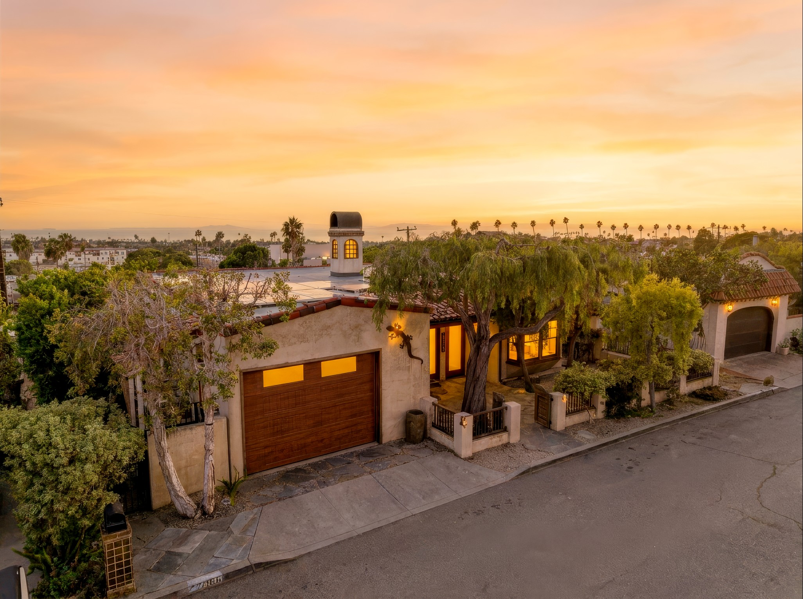
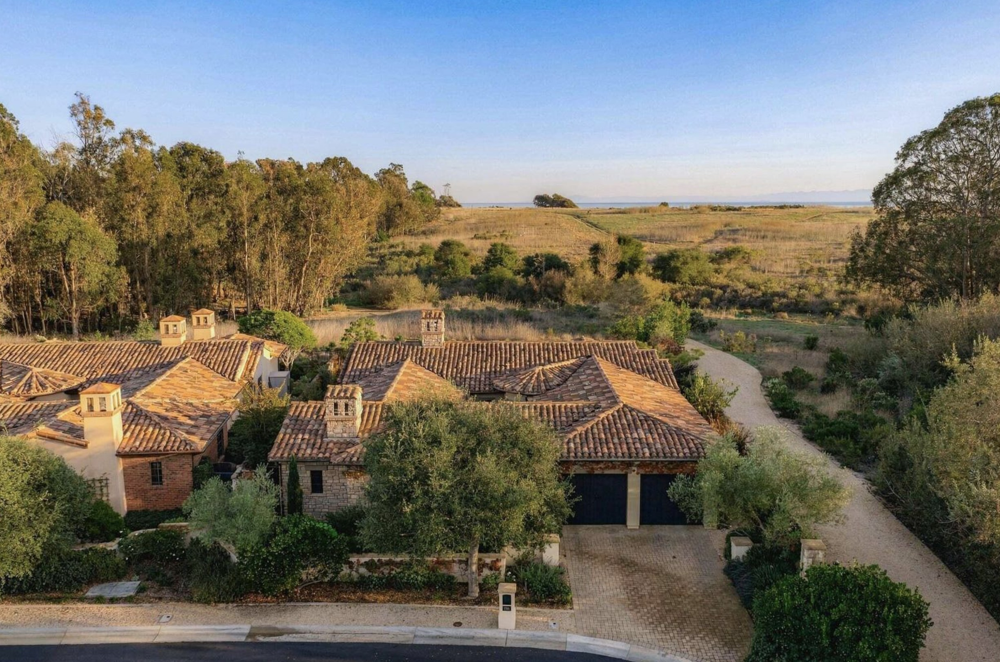
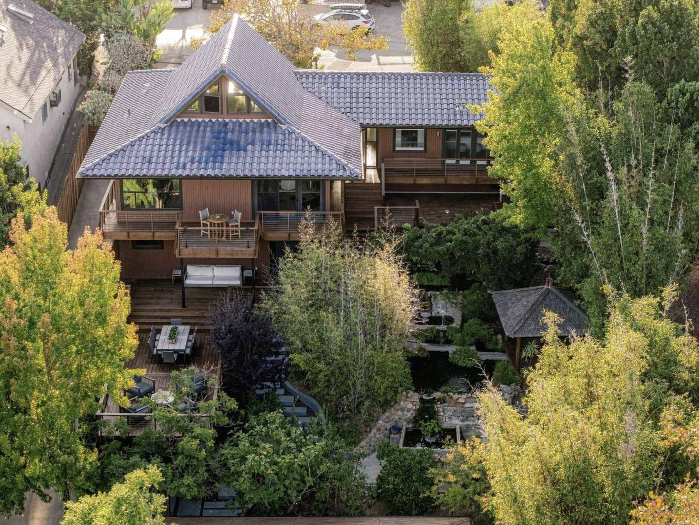
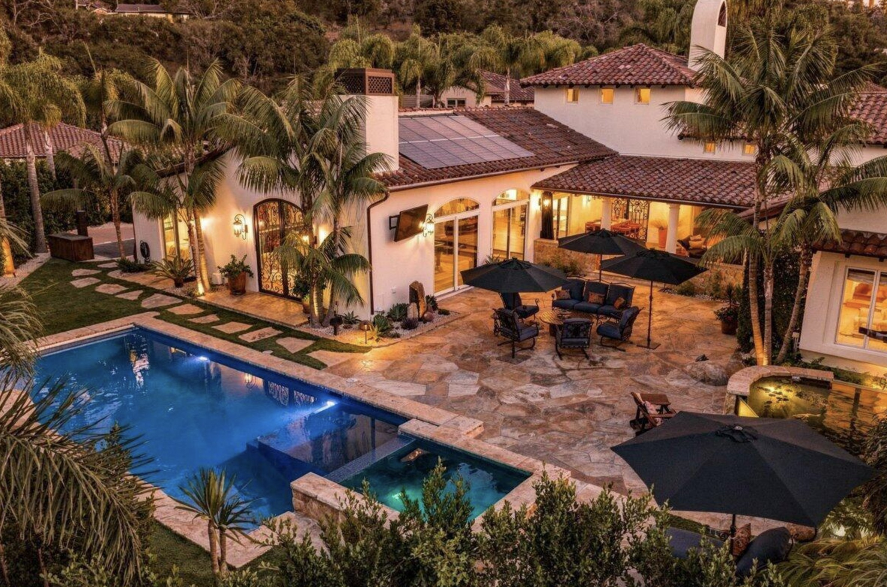
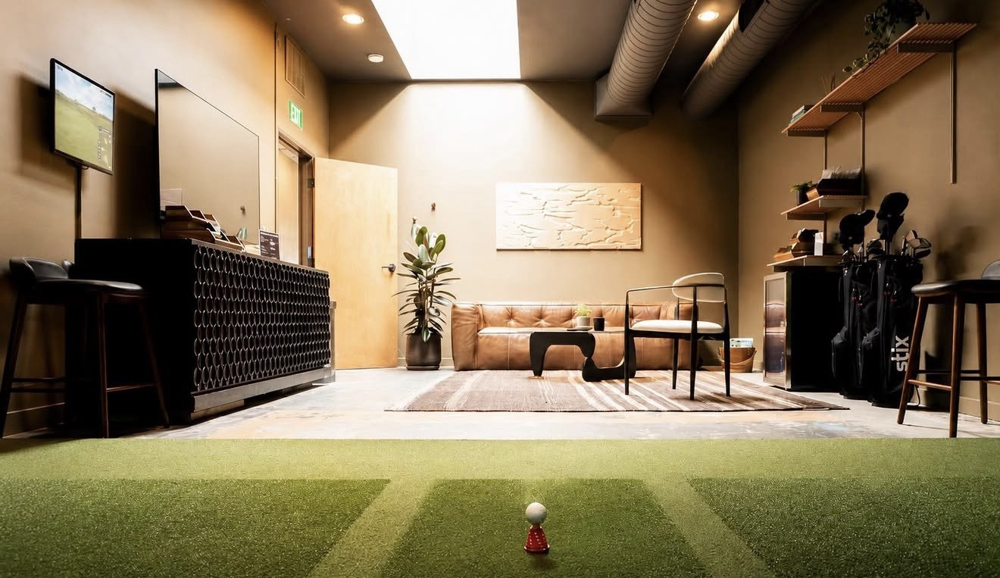
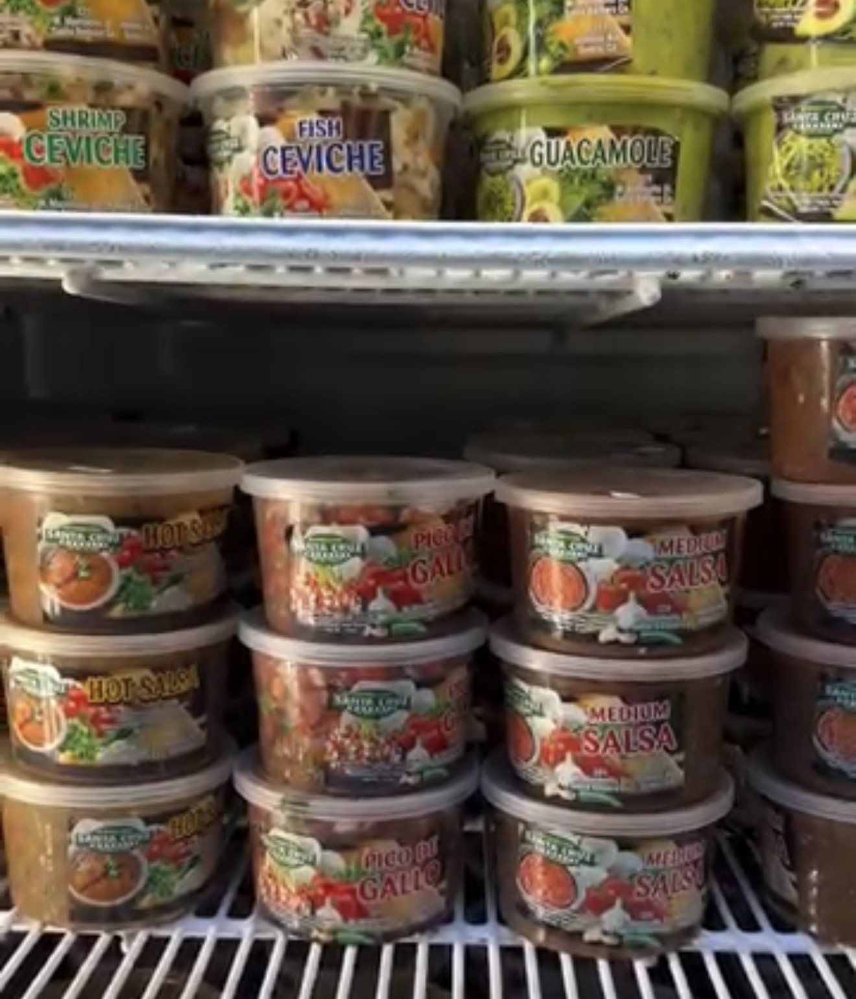
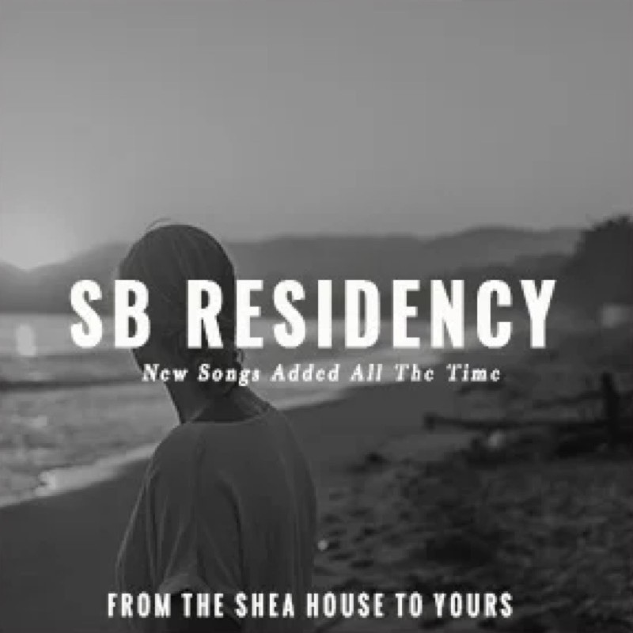
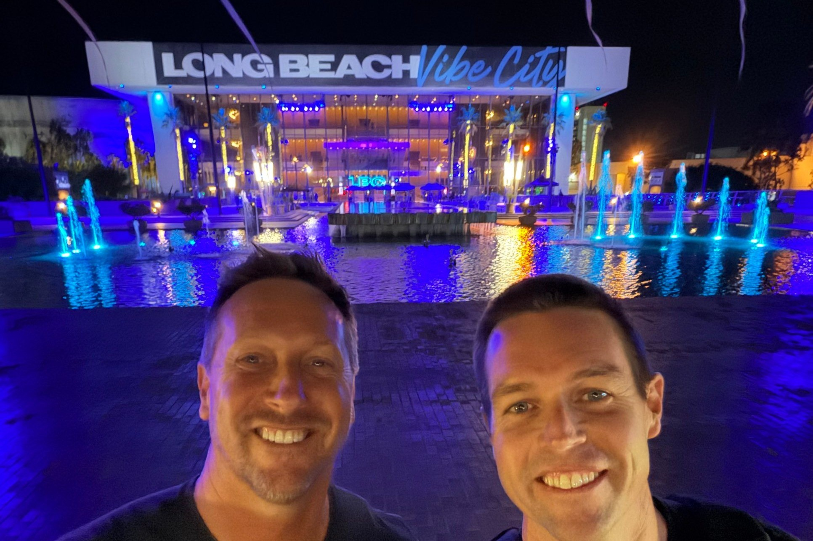

Back in the Goodland. This issue has the Goleta numbers, my new listing in Ventura, three listings that caught my eye, and a look at how I set goals. Year end is close, so the timing works. Let's get into it.

## The Nitty Gritty

*This issue's market, by the numbers.*

**Flat price. Same speed.** Single family homes in the Goleta Valley sold for about the same median price as a year ago, and the median home took 15 days to sell in both years. More of them moved fast this time: 68% of single family sales closed within 30 days, up from 62%.

Condos and townhome style PUDs show a higher median than last year, but I wouldn't read that as appreciation. It's 26 sales, and the mix of condos and PUDs changed. It's a small sample, so I'm showing the numbers and leaving it there.

**Goleta Valley, single family homes**
*Closed sales, MLS Areas 30 (SB/GOL South) and 35 (SB/GOL North). Source: FLEX MLS.*

- **Aug 25 to Nov 22, 2026 (90 days):** 57 sales, median price $1,750,000, median 15 days on market
- **Same window in 2025 (Aug 25 to Nov 22):** 58 sales, median price $1,753,500, median 15 days on market
- **Closed within 30 days:** 68% of sales, compared to 62% last year

**Goleta Valley, condos and PUDs**

- **Aug 25 to Nov 22, 2026 (90 days):** 26 sales, median price $1,160,000, median 39.5 days on market
- **Same window in 2025:** 26 sales, median price $1,050,000, median 30 days on market

**Inventory snapshot (as of Nov 23, 2026)**

- **Single family homes:** 35 active, roughly 1.8 months of supply at the current pace
- **Condos and PUDs:** 25 active, roughly 2.9 months of supply

*How I counted: closed sales in MLS Areas 30 and 35, August 25 to November 22, 2026, compared to the same dates in 2025. Days on market are cumulative, including time before any relist. Excluded: duplicate listing records, manufactured homes, ranch and fractional properties, and closings that appear to be off-market deals (one day on market or less). Condos and PUDs are grouped together. All figures are medians, not averages. Active counts remove duplicate and stale records. Source: FLEX MLS, deemed reliable but not guaranteed.*

## My Listings

*Ventura Views, above the city, with the Pacific across the horizon.*

**[2166 Palomar Avenue, Ventura: $2,249,000](https://www.flexmls.com/share/EsrHg/2166-Palomar-Avenue-VENTURA-CA-93001)**

3 bed, 3 bath, about 3,129 sq ft on 0.15 acre in Ventura Heights. This custom Spanish residence was built in 1929 and taken to the studs in 2005, and it opens up 180 degree ocean, island and coastline views from both levels. There's a skylit great room, four doors to a full width viewing deck, and a granite island kitchen with double ovens and a gas cooktop. Outside, you'll find flagstone patios, citrus, a bocce court, an outdoor shower, and a rooftop vantage. Owned solar, EV ready.
Listing courtesy of Todd Shea, Berkshire Hathaway HomeServices California Properties. (MLS #26-3599)

Want a look? [Get in touch](https://toddshearealtor.com/contact.html).

## Window Shopping

*Some listings that caught my eye this issue.*

Three this issue: one on the Ellwood bluffs, and two up in the 93110.

**[7702 Kestrel Lane, Goleta: $3,749,000](https://www.flexmls.com/share/EsrBE/7702-Kestrel-Lane,-GOLETA,-CA-93117)**

3 bed, 3.5 bath, about 3,229 sq ft on 0.25 acre. It's a single level home built in 2013, tucked at the end of a cul-de-sac in a gated community, and it backs up to 230 acres of open space with 10 miles of trails. Sandpiper Golf Club and the Ritz-Carlton Bacara are close by. Massive bi-fold doors blend the great room and the covered patio. There's an attached guest suite, a 3 car garage, and a south facing backyard.
Listing courtesy of Devin Wong, Village Properties. (MLS #26-3794)

**[304 Sherwood Drive, Santa Barbara: $2,870,000](https://www.flexmls.com/share/EsrFP/304-Sherwood-Drive-SANTA-BARBARA-CA-93110)**

3 bed, 2.5 bath, about 2,948 sq ft on 0.45 acre, built in 1993 and renovated. The new chef's kitchen has Autunnale quartzite counters, painted oak cabinets, a Wolf double oven, and a Sub-Zero refrigerator and wine fridge. It opens to a circular great room with vaulted tongue and groove ceilings and rough hewn beams. There's wide plank oak flooring throughout, a hardwired security system, and expansive ipe decking. Out back, there are koi ponds and a Balinese tea house.
Listing courtesy of Ali Evans, Berkshire Hathaway HomeServices California Properties. (MLS #26-3858)

**[4652 Vintage Ranch Lane, Santa Barbara: $6,150,000](https://www.flexmls.com/share/Esqer/4652-Vintage-Ranch-Lane-SANTA-BARBARA-CA-93110)**

5 bed, 4.5 bath, about 5,188 sq ft on 0.48 acre, built in 2002. White stucco, clay tile, and wrought iron mark the gated Spanish estate, and wrought iron doors open to double height ceilings, rustic beams, and clerestory light. There are three fireplaces. The kitchen flows into a sunlit breakfast banquette, with an overflow kitchen and coffee bar behind it. The listing photos show a pool and spa, a koi pond, a sports court, a wine room, a pub bar, and a golf simulator.
Listing courtesy of Adam McKaig, Douglas Elliman of California, Inc. (MLS #26-3734)

*Quick note: none of the above are my listings, just three that caught my eye this issue. Full credit to the listing agents and offices named above.*

## This Issue's Vibe

*Local adventurers, storytellers, eats & other must-follows.*

**Follow:** [@neighborhoodbunker](https://www.instagram.com/neighborhoodbunker/) An indoor golf simulator, back in the Goodland at 5879 Hollister Avenue in Old Town Goleta.

**Follow:** [@santacruzmarkets](https://www.instagram.com/santacruzmarkets/) The go to in Goleta for an awesome butcher and fresh produce. Find them at 5757 Hollister Avenue.

**House Radio**

*The soundtrack to the SB Residency, updated all the time.*

Everything we're listening to here in Santa Barbara, updated all the time.

*On repeat this issue:* Buffalo Traffic Jam, a folk duo out of Bozeman, Montana. Frankie Cassidy and Nathan Ross met as students at Montana State, and their debut album, *Pictures of You*, came out this summer. Two to start with on the playlist: "Fool's Gold," which has since gone RIAA Gold, and "Barely Holding On."

[Listen on Spotify](https://open.spotify.com/playlist/7gexMzDUJ3CiGideZIzdlg)

**Currently Obsessed With: Brothers Weekend**

*Whatever's got my attention this cycle, tool, trend, or otherwise.*

*Seven years in, still the best return on time I've found.*

The best ideas I've had in the last seven years came from the same place: a room full of creative, loving people with nothing else on the agenda. For me, that room is a weekend with my brother Devin.

We meet every three to four months, and we always do one right before the end of the year so we can set the bigger goals for the next one. This round was Long Beach. We got real work done in a hotel lobby with a great coffee shop, had a fun dinner out, then wrapped up over breakfast the next morning.

The format is simple. We review what came out of the last meeting, check off what got done, and talk through what's working, what's not, and why. Then we set 90 day goals and to-dos across every category: life, love, business, all of it. Everything goes into Notion, with notes, a summary and action items. The real work is reviewing it once we're home and life gets busy.

Every year I show up with my own list of thoughts and ideas. And every year, some of the best ones never come off the list. They show up in the back and forth, in long, loose brainstorming sessions with no agenda and nowhere to be. Devin owns his own chiropractic practice and has a family in San Diego, so his challenges are not mine, and that's the point. I leave with ideas for my business and my family that came out of his world, and he leaves with the same from mine. Two guys, two different seats at the same table, trading notes.

Every time, I leave with ideas that have changed my business, my relationships and my life. It's the best return on time I've found, and it's brought my brother and me a lot closer.

Your turn. Grab a family member, a friend or a few people and set your first one before the year ends. Want the format? [Get in touch](https://toddshearealtor.com/contact.html) and I'll walk you through how we've run it.

## Ready When You Are

*Buying, selling, or just curious what it's worth? I'm here.*

Thinking about Goleta, Santa Barbara, or anywhere from the Santa Ynez Valley to Ventura? Let's talk.

[Get in touch](https://toddshearealtor.com/contact.html)
